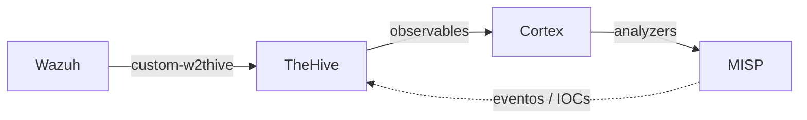

# &nbsp; Cortex

Cortex es una plataforma de análisis que permite consultar observables (IPs, correos, URLs, dominios, archivos y hashes) desde un único lugar. Funciona como punto central de inteligencia de amenazas, análisis forense y respuesta a incidentes, y expone una API REST para automatizar tareas.

En este laboratorio Cortex se integra con el resto del stack:



- **Wazuh** detecta y envía las alertas a **TheHive**.
- **TheHive** gestiona los casos y envía los observables a **Cortex**.
- **Cortex** los analiza y consulta a **MISP** para enriquecerlos con inteligencia de amenazas.

Documentación oficial: [Cortex](https://docs.thehive-project.org/cortex/)

## 📚 Tabla de contenido

- [Requisitos](#requisitos)
- [Instalación](#instalación)
  - [Actualizar el sistema](#actualizar-el-sistema)
  - [Instalar Java](#instalar-java)
  - [Instalar Elasticsearch](#instalar-elasticsearch)
  - [Instalar Cortex](#instalar-cortex)
- [Configuración](#configuración)
  - [Configurar Elasticsearch](#configurar-elasticsearch)
  - [Configurar Cortex](#configurar-cortex)
  - [Configurar Analyzers y Responders](#configurar-analyzers-y-responders)
- [Inicio de los servicios](#inicio-de-los-servicios)
  - [Iniciar Elasticsearch](#iniciar-elasticsearch)
  - [Iniciar Cortex](#iniciar-cortex)
  - [Crear cuentas y organización](#crear-cuentas-y-organización)
  - [Habilitar Analyzers y Responders](#habilitar-analyzers-y-responders)
- [Integración con MISP](#integración-con-misp)
- [Integración con TheHive](#integración-con-thehive)
- [Seguridad (HTTPS con Nginx)](#seguridad-https-con-nginx)
  - [Instalar Nginx y OpenSSL](#instalar-nginx-y-openssl)
  - [Generar certificado autofirmado](#generar-certificado-autofirmado)
  - [Configurar Nginx](#configurar-nginx)
  - [Restringir el acceso al puerto 8090](#restringir-el-acceso-al-puerto-8090)
  - [Firewall o grupos de seguridad](#firewall-o-grupos-de-seguridad)

## Requisitos

- Ubuntu 22.04 LTS (o similar) en una VM, ya sea en la nube (AWS EC2, etc.) o en local.
- Mínimo 4 GB de RAM (Elasticsearch y Cortex consumen bastante).
- Acceso a internet y usuario con `sudo`.

## 💻 Instalación

### Actualizar el sistema

```bash
sudo apt update && sudo apt upgrade -y
```

Instala las dependencias necesarias:

```bash
sudo apt install -y wget gnupg apt-transport-https git ca-certificates ca-certificates-java curl software-properties-common python3-pip lsb-release
```

### Instalar Java

```bash
sudo apt install -y openjdk-11-jre-headless
java -version
```

### Instalar Elasticsearch

Cortex funciona con Elasticsearch 7.x:

```bash
wget -qO - https://artifacts.elastic.co/GPG-KEY-elasticsearch | sudo gpg --dearmor -o /usr/share/keyrings/elasticsearch-keyring.gpg
echo "deb [signed-by=/usr/share/keyrings/elasticsearch-keyring.gpg] https://artifacts.elastic.co/packages/7.x/apt stable main" | sudo tee /etc/apt/sources.list.d/elastic-7.x.list
sudo apt update
sudo apt install -y elasticsearch
```

### Instalar Cortex

```bash
wget -qO- https://raw.githubusercontent.com/TheHive-Project/Cortex/master/PGP-PUBLIC-KEY | sudo gpg --dearmor -o /usr/share/keyrings/thehive-project.gpg
echo 'deb [signed-by=/usr/share/keyrings/thehive-project.gpg] https://deb.thehive-project.org release main' | sudo tee /etc/apt/sources.list.d/thehive-project.list
sudo apt update
sudo apt install -y cortex
```

> [!NOTE]
> Si el repositorio APT no responde, revisa la [documentación oficial](https://docs.thehive-project.org/cortex/) por si cambió la URL o el método de instalación.

## ⚙️ Configuración

### Configurar Elasticsearch

Para que Cortex se conecte a Elasticsearch, este debe escuchar solo en localhost. Edita `/etc/elasticsearch/elasticsearch.yml`:

```yml
http.host: 127.0.0.1
transport.host: 127.0.0.1
cluster.name: hive
thread_pool.search.queue_size: 100000
path.logs: "/var/log/elasticsearch"
path.data: "/var/lib/elasticsearch"
xpack.security.enabled: false
script.allowed_types: "inline,stored"
```

> [!NOTE]
> Si TheHive corre en el mismo servidor y comparte este Elasticsearch, usa índices distintos para cada servicio y asegúrate de que la RAM alcance para ambos.

### Configurar Cortex

Edita `/etc/cortex/application.conf`.

**1. Conexión a Elasticsearch:**

```conf
search {
  # Nombre del índice
  index = cortex
  # Dirección de Elasticsearch
  uri = "http://127.0.0.1:9200"
}
```

**2. Puerto y dirección de escucha.** Cortex usa el puerto 9001 por defecto. Aquí lo cambiamos a 8090 y lo dejamos escuchando solo en localhost, ya que el acceso externo será por Nginx (HTTPS):

```conf
http.port = 8090
http.address = 127.0.0.1
```

> [!NOTE]
> Si TheHive o los analizadores necesitan llegar a Cortex desde otro servidor antes de configurar Nginx, quita temporalmente `http.address`. Recuerda volver a ponerlo después.

> [!NOTE]
> La clave secreta (`play.http.secret.key`) se genera automáticamente al instalar el paquete en `/etc/cortex/secret.conf`. No la borres ni la subas a GitHub.

### Configurar Analyzers y Responders

Los Analyzers y Responders son el núcleo de Cortex: permiten analizar y responder usando muchas fuentes de datos.

**1. Instala las dependencias:**

```bash
sudo apt install -y --no-install-recommends python3-pip python3-dev ssdeep libfuzzy-dev libfuzzy2 libimage-exiftool-perl libmagic1 build-essential git libssl-dev
sudo pip3 install -U pip setuptools
```

**2. Descarga los módulos en `/opt`:**

```bash
cd /opt
sudo git clone https://github.com/TheHive-Project/Cortex-Analyzers
```

**3. Instala los requisitos de Python de cada módulo:**

```bash
for I in $(find Cortex-Analyzers -name 'requirements.txt'); do sudo -H pip3 install -r $I || true; done
```

> [!NOTE]
> La descarga puede tardar bastante por la cantidad de módulos. En Ubuntu 24.04 `pip` bloquea instalaciones globales (PEP 668); en ese caso agrega `--break-system-packages` o usa Ubuntu 22.04.

**4. Da permisos a Cortex sobre el directorio:**

```bash
sudo chown -R cortex:cortex /opt/Cortex-Analyzers
```

**5. Indica a Cortex dónde están los módulos** en `/etc/cortex/application.conf`:

```conf
analyzer {
  urls = [
    "/opt/Cortex-Analyzers/analyzers"
  ]

  fork-join-executor {
    parallelism-min = 2
    parallelism-factor = 2.0
    parallelism-max = 4
  }
}

responder {
  urls = [
    "/opt/Cortex-Analyzers/responders"
  ]

  fork-join-executor {
    parallelism-min = 2
    parallelism-factor = 2.0
    parallelism-max = 4
  }
}
```

> [!IMPORTANT]
> Los directorios se llaman `analyzers` (plural) y `responders`. Si pones `analyzer` en singular, Cortex no encontrará ningún módulo.

## 🚀 Inicio de los servicios

### Iniciar Elasticsearch

```bash
sudo systemctl enable elasticsearch
sudo systemctl start elasticsearch
sudo systemctl status elasticsearch
```

Si falla, revisa los logs:

```bash
sudo journalctl -u elasticsearch -n 100
# o en el directorio de logs:
ls /var/log/elasticsearch
```

### Iniciar Cortex

Con Elasticsearch funcionando:

```bash
sudo systemctl enable cortex
sudo systemctl start cortex
sudo systemctl status cortex
```

Si falla, revisa los logs:

```bash
sudo journalctl -u cortex -n 100
# o en el directorio de logs:
ls /var/log/cortex
```

### Crear cuentas y organización

Los servicios pueden tardar unos minutos en iniciar. Cuando estén listos, Cortex estará en `http://IP_DEL_SERVIDOR:8090/` (si ya configuraste `http.address = 127.0.0.1`, accede desde el propio servidor o configura primero Nginx).

1. Abre Cortex en el navegador.
2. La primera vez te pedirá **actualizar la base de datos**; esto crea los índices en Elasticsearch.
3. Crea tu primer usuario, que será el **administrador global** (superadmin).
4. Inicia sesión con esa cuenta. Tiene funciones limitadas: haz clic en ***Add Organization*** para crear una organización.
5. Dentro de la organización, haz clic en ***Add User*** y asigna los roles ***Read, Analyze, orgadmin***.
6. En el usuario nuevo, haz clic en ***New Password*** para definir su contraseña.
7. Cierra sesión del administrador global (arriba a la derecha) e ingresa con el nuevo usuario.

### Habilitar Analyzers y Responders

Con la cuenta de la organización, ve a **Organization > Analyzers** y habilita los que necesites. Lo mismo para los Responders en **Organization > Responders**.

## 🔎 Integración con MISP

Cortex incluye analizadores para consultar MISP. En **Organization > Analyzers**, busca los de MISP (por ejemplo `MISP_2_1`), habilítalos y completa su configuración:

| Parámetro | Descripción |
|---|---|
| `name` | Nombre de tu instancia MISP (libre). |
| `url` | URL de tu MISP, por ejemplo `https://IP_DE_MISP`. |
| `key` | Clave de automatización (API key) de un usuario de MISP. |
| `cert_check` | `false` si MISP usa certificado autofirmado; `true` en caso contrario. |

> [!NOTE]
> Usa una API key de MISP con los permisos mínimos necesarios y no la subas a GitHub.

## 🐝 Integración con TheHive

**1. Crea un usuario para TheHive en Cortex.** Dentro de tu organización, crea un usuario (por ejemplo `thehive`) con roles ***Read, Analyze***. Luego haz clic en ***Create API Key*** y después en ***Reveal*** para copiar la clave.

**2. Configura TheHive.** En `/etc/thehive/application.conf` agrega:

```conf
play.modules.enabled += org.thp.thehive.connector.cortex.CortexModule

cortex {
  servers = [
    {
      name = "Cortex"
      url = "http://IP_DE_CORTEX:8090"
      auth {
        type = "bearer"
        key = "TU_API_KEY_DE_CORTEX"
      }
    }
  ]
}
```

**3. Reinicia TheHive:**

```bash
sudo systemctl restart thehive
```

> [!NOTE]
> Si Cortex queda escuchando solo en `127.0.0.1` y TheHive está en otro servidor, TheHive no podrá conectarse. En ese caso usa la URL HTTPS de Nginx (`https://IP_DE_CORTEX`) y, si el certificado es autofirmado, configura TheHive para confiar en él.

## 🔒 Seguridad (HTTPS con Nginx)

Por defecto Cortex sirve el tráfico por HTTP y no tiene soporte nativo de TLS. Con Nginx como proxy inverso, la comunicación entre el servidor y el usuario viaja cifrada.

### Instalar Nginx y OpenSSL

```bash
sudo apt install -y nginx openssl
```

### Generar certificado autofirmado

```bash
sudo mkdir -p /etc/nginx/certs
sudo openssl req -x509 -nodes -newkey rsa:4096 -days 365 \
  -keyout /etc/nginx/certs/cortex.key \
  -out /etc/nginx/certs/cortex.crt \
  -subj "/CN=cortex"
sudo chmod 600 /etc/nginx/certs/cortex.key
```

### Configurar Nginx

Crea el archivo `/etc/nginx/sites-available/cortex.conf`:

```conf
server {
    listen 443 ssl;
    server_name _;

    ssl_certificate     /etc/nginx/certs/cortex.crt;
    ssl_certificate_key /etc/nginx/certs/cortex.key;

    ssl_protocols       TLSv1.2 TLSv1.3;
    ssl_prefer_server_ciphers off;
    ssl_session_timeout 1d;
    ssl_session_cache   shared:SSL:50m;

    proxy_connect_timeout   600;
    proxy_send_timeout      600;
    proxy_read_timeout      600;
    send_timeout            600;
    client_max_body_size    2G;
    proxy_buffering         off;
    client_header_buffer_size 8k;

    location / {
        proxy_pass              http://127.0.0.1:8090/;
        proxy_http_version      1.1;
        proxy_set_header        Upgrade $http_upgrade;
        proxy_set_header        Connection 'upgrade';
        proxy_set_header        Host $host;
        proxy_set_header        X-Real-IP $remote_addr;
        proxy_set_header        X-Forwarded-For $proxy_add_x_forwarded_for;
        proxy_set_header        X-Forwarded-Proto $scheme;
        proxy_cache_bypass      $http_upgrade;
    }
}
```

Actívalo y elimina el sitio por defecto:

```bash
sudo ln -s /etc/nginx/sites-available/cortex.conf /etc/nginx/sites-enabled/cortex.conf
sudo rm -f /etc/nginx/sites-enabled/default
```

Verifica la configuración y recarga Nginx:

```bash
sudo nginx -t
sudo systemctl reload nginx
```

Cortex ya debería estar disponible en `https://IP_DEL_SERVIDOR`. El navegador mostrará una advertencia porque el certificado es autofirmado.

> [!NOTE]
> Con un dominio real puedes usar Let's Encrypt (`certbot`) en lugar de un certificado autofirmado y agregar el encabezado `Strict-Transport-Security`.

### Restringir el acceso al puerto 8090

Como en la configuración de Cortex pusimos `http.address = 127.0.0.1`, el puerto 8090 solo acepta conexiones locales y no hace falta usar `iptables`. Comprueba qué puertos están abiertos:

```bash
ss -tuln
```

Deberías ver `127.0.0.1:8090` (solo local) y `0.0.0.0:443` (Nginx).

### Firewall o grupos de seguridad

Aplica el principio de mínimo privilegio y abre solo lo necesario:

| Puerto | Uso | Origen recomendado |
|---|---|---|
| 22 | SSH | Solo tu IP |
| 443 | Cortex (HTTPS) | TheHive y los analistas |

No expongas los puertos 9200 (Elasticsearch) ni 8090 (Cortex sin cifrar).